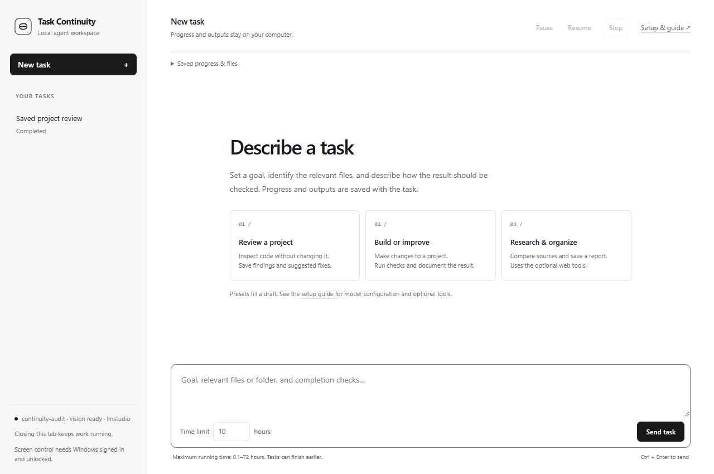

# Task Continuity Agent

[](https://github.com/orcaonmars/task-continuity-agent/actions/workflows/validate.yml)

I made this because I wanted something for longer local AI tasks, including overnight work, without having to keep checking on everything. Figured other people might want something similar.

Task Continuity Agent is a Windows app that saves the task and its progress, keeps track of background jobs, and can recover after worker interruptions. You give it a task through a browser interface and check the saved work there.

I've completed an overnight endurance run. In my testing, it usually works, but sometimes gets stuck and needs intervention. It's still experimental, and the model you use makes a difference.



## Get started

1. **[Download the ZIP](https://github.com/orcaonmars/task-continuity-agent/archive/refs/heads/main.zip)** and extract it into a folder you can write to. Don't run it from inside the ZIP.
2. **Double-click `Start Task Continuity.cmd`.** It finds Python or tries to install Python 3.12 for your Windows account, installs the app's dependencies, checks the installation, and creates a Desktop shortcut. The first setup needs internet and can take a few minutes.
3. **Set up your model in LM Studio.** Setup can offer to install [LM Studio](https://lmstudio.ai/) too. Open it, download and load a model that supports tools, then start the local server in its **Developer** tab. Pick a model that fits your computer; models are downloaded separately.
4. **Finish in the app.** Open **Connection setup**, keep the default address if you're using LM Studio, and select **Save and check connection**. Once it connects, you're ready to send a task.

After that, use the Desktop shortcut or double-click the same file again. It reuses a healthy installation. Your existing configuration and saved tasks are kept.

You need Windows 10 or 11. Automatic Python and LM Studio installation uses Windows App Installer (WinGet) with per-user installs. If WinGet isn't available, setup gives you a manual download link. Open the launcher normally, without **Run as administrator**.

Already using another local model server? Choose **Other compatible server** in Connection setup and enter its API address. It needs streaming chat completions and tool-call support. See [configuration](docs/configuration.md) for the details.

## Give it a real task

Select **New task**, describe what you want, include the relevant file or folder paths, and say what the finished result should look like. Choose a time limit and select **Send task**. There are editable examples for project reviews, coding, and research.

For example:

```text
Review C:\Projects\example for reliability issues. Do not modify or run the project.
Save findings.md in this task's folder with prioritized findings, file references,
evidence, and suggested fixes. Separate confirmed bugs from things that need testing.
```

Replace that path with your project. You can use it for file processing, project maintenance, research, and optional Blender work. More [task examples](docs/example-tasks.md) are in the docs.

- **Pause** pauses reasoning; background jobs may keep running.
- **Stop** cancels the task's background jobs and keeps saved progress.
- **Resume** continues saved work with a fresh time budget.

The time limit can be 0.1–72 hours. It's a maximum, so tasks can finish earlier. Only one task controls the computer at a time. Closing the browser tab leaves the app running.

## Find your files

Open **Saved progress & files** for checkpoints and **Open task folder**. Tasks normally save under `data/Tasks/<task-id>/`. Reported documents have Open buttons; scripts are shown in their folder rather than executed. If you asked it to edit an external project, some files can be there instead.

Keep the computer powered. Desktop interaction needs Windows signed in and unlocked. Shutdown and power loss end running processes.

## What it checks, and what it doesn't

The app checks required output files, their structure, and recorded verification. Numerical data tasks need a successful tracked calculation or verification job covering the saved outputs. That helps catch unsupported completion claims, but it doesn't prove every answer or algorithm is correct.

The suite contains **190 Python tests and 23 interface checks**. GitHub CI checks Windows with Python 3.11, 3.12, and 3.14, plus known dependency advisories. The [November audit](docs/audit-2026-11.md) includes a failed live trial and what changed afterward. See [release status](RELEASE-STATUS.md) and [Actions](https://github.com/orcaonmars/task-continuity-agent/actions/workflows/validate.yml) for the tested scope and current results. A 50-hour endurance run is still unverified.

This runs with your Windows account's permissions; it isn't a sandbox. Keep backups of important files. Models run through your chosen server, but web tools and optional integrations can contact external services. Saved tasks and downloads don't have a total storage quota. See [security and privacy](SECURITY.md).

## Help and more details

- [Setup, controls, and troubleshooting](00-START-HERE.md)
- [Model settings and optional tools](docs/configuration.md)
- [Blender setup](docs/blender.md)
- [How recovery and background jobs work](docs/architecture.md)
- [Roadmap](docs/roadmap.md) and [contributing](CONTRIBUTING.md)

Python 3.11+ is required; the launcher can install it when needed. Screenshot or render review needs an image-capable model. Chrome or Edge, ffmpeg, Blender, and extra integrations are only needed for the features that use them.

<details>
<summary>Manual setup and development</summary>

If you prefer PowerShell, open it in the extracted project folder:

```powershell
powershell -NoProfile -ExecutionPolicy Bypass -File .\install.ps1
powershell -NoProfile -ExecutionPolicy Bypass -File .\start-agent.ps1
```

To validate or build a source ZIP:

```powershell
powershell -NoProfile -ExecutionPolicy Bypass -File .\scripts\validate.ps1
powershell -NoProfile -ExecutionPolicy Bypass -File .\scripts\build.ps1
```

Node.js is optional for running the interface checks; the app itself doesn't need it. Builds go into `dist/` with a checksum and file manifest. Runtime configuration, task data, models, browser profiles, and `.venv` are excluded. See [publishing](docs/publishing.md) before sharing an installed copy.

</details>

## About the project

I'm not an experienced developer. I wrote some of the code myself, but AI helped write a large chunk of the code and docs. I've been directing what I need it to do and using AI to work through bugs, tests, and refinements. It's taken a lot of iteration, and I'm still learning.

If you try it, I'd appreciate hearing which model you used, what task you gave it, and where it worked or got stuck. Suggestions and criticism are welcome.

[MIT licence](LICENSE). Created by [orcaonmars](https://github.com/orcaonmars).
