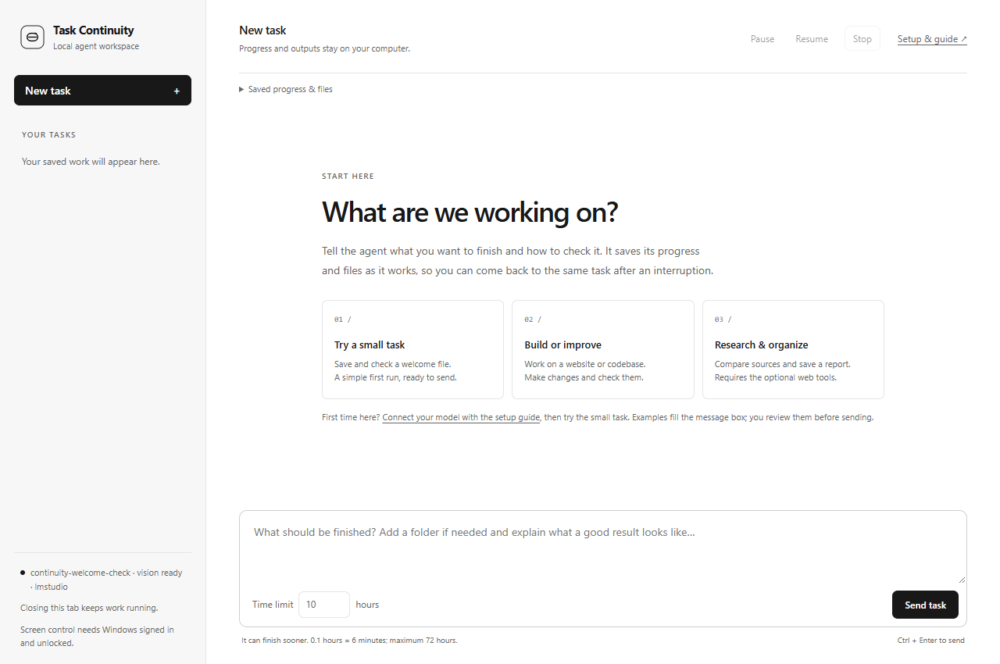

# Task Continuity Agent

[](https://github.com/orcaonmars/task-continuity-agent/actions/workflows/validate.yml)

A Windows application for running extended tasks with local, tool-capable models. It preserves task state across worker restarts, manages independent background jobs, and checks outputs before accepting completion.

Use it for project maintenance, file processing, research, and optional Blender workflows. In my testing, it usually works, but it sometimes gets stuck and needs manual intervention. This is an experimental source release; see [validation and limitations](#validation-and-limitations).

[Installation](#installation) · [Usage](#usage) · [Documentation](#documentation) · [Contributing](CONTRIBUTING.md)



## Features

- **Persistent task state:** original briefs, checkpoints, tool results, and outputs survive model and supervisor restarts.
- **Independent jobs:** tracked commands, conversions, and renders have their own process identities, deadlines, logs, and results.
- **Output verification:** completion checks inspect files, structure, hashes, and current visual evidence where supported.
- **Bounded recovery:** a watchdog, saved model selection, timeouts, and progress checks limit repeated failures.
- **Capability groups:** core file and job tools, web, desktop, media, optional Blender, and additional MCP servers.

## Requirements

- Windows 10 or 11 and [Python 3.11+](https://www.python.org/downloads/windows/).
- A local model server with streaming chat completions and tool-call support. [LM Studio](https://lmstudio.ai/) is the default backend; other local OpenAI-compatible servers require [configuration](docs/configuration.md).
- An image-capable model for screenshot or render review. Text-only models support file, code, and page-structure workflows.

Models are installed separately. Chrome or Edge, ffmpeg, Blender, and extra integrations are required only for their respective capabilities.

## Installation

Clone the repository, or [download and extract the source](https://github.com/orcaonmars/task-continuity-agent/archive/refs/heads/main.zip) into a writable folder. Run these commands in a normal PowerShell window:

```powershell
git clone https://github.com/orcaonmars/task-continuity-agent.git
cd task-continuity-agent
powershell -NoProfile -ExecutionPolicy Bypass -File .\install.ps1
```

If using the downloaded ZIP, open PowerShell in the extracted project folder and run only the installer command. The installer creates `.venv`, validates dependencies and tests, writes `data/config.json`, and adds a Desktop shortcut.

In LM Studio, load a tool-capable model and enable **Developer → Start server**. The default API endpoint is `http://127.0.0.1:1234/v1`. See the [LM Studio server documentation](https://lmstudio.ai/docs/developer/core/server) for details.

Start the application:

```powershell
powershell -NoProfile -ExecutionPolicy Bypass -File .\start-agent.ps1
```

The interface opens at `http://127.0.0.1:8765/` by default. The launcher uses a watchdog; closing the browser tab leaves work running. The [installation and usage guide](00-START-HERE.md) covers configuration, controls, and troubleshooting.

## Usage

Select **New task**, describe the objective and relevant files, choose a time limit, and select **Send task**. Include the expected deliverables and completion checks. The interface provides editable presets for project review, implementation, and research.

For example, a source review can produce a useful report without modifying the project:

```text
Review C:\Projects\example for reliability issues. Do not modify or run the project.
Save findings.md in this task's folder with prioritized findings, file references,
evidence, and proposed fixes. Separate confirmed defects from unverified risks.
```

Replace the example path with your project. Outputs normally live under `data/Tasks/<task-id>/`; the task's folder and reported files appear in **Saved progress & files**. An explicitly selected external project can also contain edited files.

Time limits range from **0.1 to 72 hours**. Work can finish before the deadline. **Pause** stops reasoning while existing jobs may continue; **Stop** cancels owned jobs; **Resume** continues saved work with a fresh budget. Only one task controls the computer at a time. See [task examples](docs/example-tasks.md) for coding, research, CSV processing, and Blender workflows.

## Documentation

| Guide | Contents |
| --- | --- |
| [Installation and usage](00-START-HERE.md) | Setup, configuration, controls, recovery, and troubleshooting |
| [Configuration](docs/configuration.md) | Providers, model selection, limits, and optional tools |
| [Task examples](docs/example-tasks.md) | Practical briefs and expected deliverables |
| [Blender](docs/blender.md) | Background jobs, renders, and optional live control |
| [Architecture](docs/architecture.md) | Supervisor, actor, persistence, and job ownership |
| [Release status](RELEASE-STATUS.md) | Verification evidence and known limitations |
| [Benchmarks](docs/benchmarking.md) | Reproducible reliability evaluation |
| [Roadmap](docs/roadmap.md) | Current priorities and contribution opportunities |

## Validation and limitations

Windows CI runs the regression suite with Python **3.11, 3.12, and 3.14**. Coverage includes 169 Python tests and 17 Node.js interface checks. Node.js is optional for local development and is not an application dependency. See [workflow results](https://github.com/orcaonmars/task-continuity-agent/actions/workflows/validate.yml) and [release status](RELEASE-STATUS.md) for the tested scope.

- A full overnight or 50-hour endurance run has not been completed. A compatible API and capable model are required; recovery does not guarantee task success.
- The application uses your Windows account's permissions and is not a sandbox. Keep backups. Web tools contact external sites; integrations have their own data handling. See [security and privacy](SECURITY.md).
- Desktop interaction requires an unlocked Windows session. Power loss and shutdown end running processes. Retained tasks, downloads, and outputs have no total storage quota.

## Development

```powershell
powershell -NoProfile -ExecutionPolicy Bypass -File .\scripts\validate.ps1
powershell -NoProfile -ExecutionPolicy Bypass -File .\scripts\build.ps1
```

The build validates the source and produces a reproducible source ZIP, checksum, and file manifest in `dist/`. Local configuration, task data, models, browser profiles, and `.venv` are excluded. Follow the [contribution guide](CONTRIBUTING.md) for changes and the [publishing guide](docs/publishing.md) for distribution.

## License

[MIT](LICENSE). Created by [orcaonmars](https://github.com/orcaonmars).
